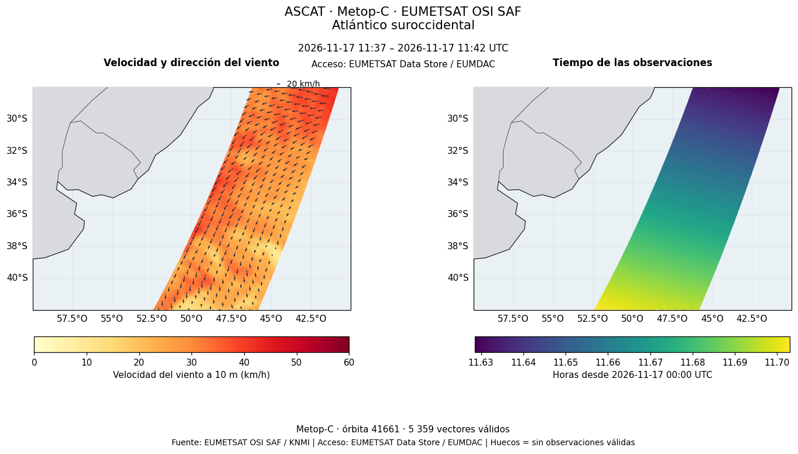
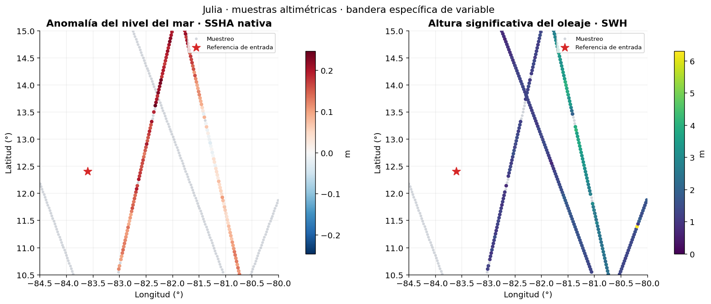
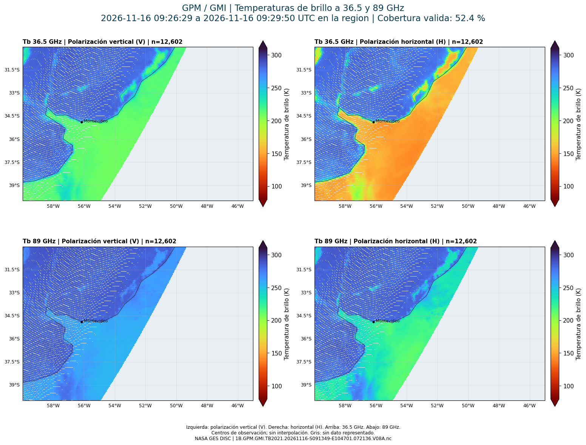
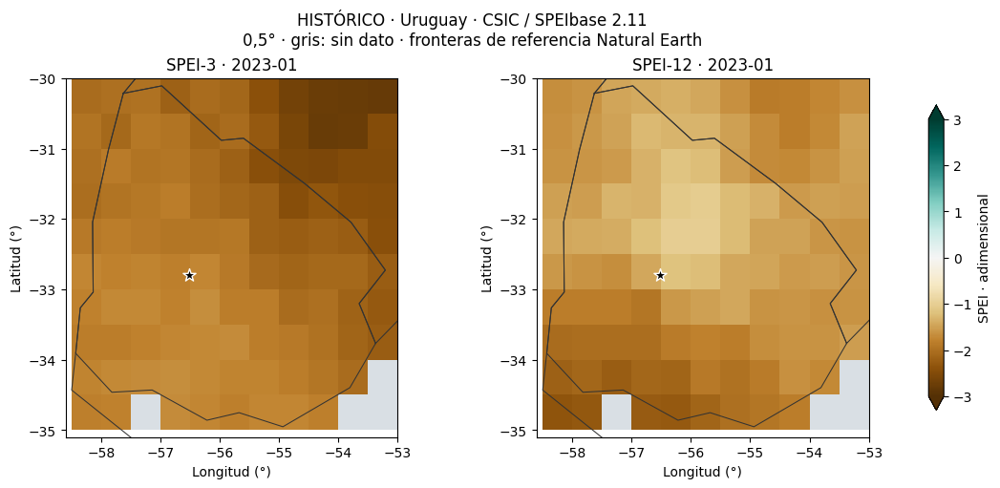

# Productos y aplicaciones de los satélites meteorológicos

**Cuadernos de formación · Uruguay · Noviembre de 2026**  
AEMET y EUMETSAT, con apoyo de AECID

Trece cuadernos para acceder a datos, revisar su calidad, interpretar los resultados y repetir el análisis en otra región. Cada cuaderno incluye sus requisitos, instrucciones y parámetros.

## Comience aquí

1. Elija una práctica en la tabla y revise las cuentas que necesita.
2. Consulte [Cuentas y acceso](GUIA_CUENTAS.md): crear una cuenta es un proceso guiado y sencillo; varias prácticas no requieren cuenta del proveedor.
3. Abra el archivo `.ipynb` en [Google Colab](https://colab.research.google.com/) mediante **Archivo → Subir cuaderno** o **Archivo → Abrir cuaderno → GitHub**. Si desea conservar los cambios, guarde una copia en su Drive.
4. Si la práctica admite Jupyter / Anaconda, también puede descargarla y seguir sus instrucciones de ejecución local.
5. Ejecute las celdas en orden y revise cada resultado antes de cambiar los parámetros.

## Prácticas y cuentas necesarias

**Google:** se necesita cuando ejecuta en Colab o utiliza Drive. En los cuadernos que admiten Jupyter / Anaconda local no se requiere Google para esa ruta.

| N.º | Práctica | Cuenta para los datos | Entorno |
| :--- | :--- | :--- | :--- |
| 01 | [SST · Acceso a datos de EUMETSAT](SST_EUMETSAT_Colab_Drive.ipynb) | EUMETSAT para nuevas descargas; el respaldo incluido y la caché válida no requieren autenticarse otra vez. | Google Colab y Google Drive |
| 02 | [SST · Visualización con NASA Worldview](SST_NASA_Worldview_Colab_Drive.ipynb) | Ninguna cuenta del proveedor: la consulta de imágenes NASA GIBS es pública. | Google Colab y Google Drive |
| 03 | [SST · Data Tailor y EUMDAC en Panamá](SST_EUMDAC_Panama.ipynb) | EUMETSAT solo en el modo descarga. Los modos muestra y consulta no necesitan cuenta EUMETSAT. | Google Colab o Jupyter / Anaconda de 64 bits |
| 04 | [ASCAT · Viento oceánico frente a Uruguay](ASCAT_NOAA_EUMDAC_Uruguay.ipynb) | Ninguna en la ruta predeterminada NOAA. EUMETSAT es opcional, solo para la ruta eumdac. | Google Colab o Jupyter / Anaconda de 64 bits |
| 05 | [GPM / GMI · Microondas sobre Uruguay](GPM_GMI_37_89GHz_Uruguay.ipynb) | NASA Earthdata para descargar gránulos. La consulta del catálogo es pública y el modo local no necesita iniciar sesión. | Google Colab o Jupyter / Anaconda de 64 bits |
| 06 | [IMERG · Precipitación diaria](IMERG_PrecipitacionDiaria_Uruguay.ipynb) | NASA Earthdata para nuevas descargas Early, Late o Final. Solo Drive reutiliza los archivos ya guardados. | Google Colab y Google Drive |
| 07 | [SPEI · Duración e intensidad de la sequía](SPEI_CSIC_Uruguay.ipynb) | Ninguna cuenta del proveedor: los NetCDF de SPEIbase del CSIC se descargan públicamente. | Google Colab y Google Drive |
| 08 | [NDVI · Diez años de vegetación](NDVI_MODIS_SeriesTiempo_Uruguay.ipynb) | Ninguna cuenta del proveedor: esta práctica utiliza la API pública TESViS de ORNL DAAC. | Google Colab o Jupyter / Anaconda de 64 bits |

## Estudios de caso y visores

| Cuaderno | Actividad |
| --- | --- |
| [Huracán Julia · altimetría en Nicaragua](Julia_Altimetria_EUMDAC_Nicaragua.ipynb) | Examine la anomalía del nivel del mar y la altura significativa de ola a lo largo de las pasadas de Sentinel. La descarga con EUMDAC requiere credenciales de EUMETSAT. |
| [GOES ABI · radiancia volcánica](INSIVUMEH_GOES_16_18_19_C07_Radiancia_Exacta_12h.ipynb) | Calcule la diferencia entre el máximo y la media espacial de radiancia del canal 7 y siga su evolución con una media móvil de 12 horas. |
| [GOES · ceniza volcánica](INSIVUMEH_GOES_16_18_19_RGB_Animaciones_24h.ipynb) | Compare composiciones RGB y anime secuencias de GOES-19 para seguir la evolución de una pluma. |
| [Landsat 8 y 9 · observación de volcanes](INSIVUMEH_Landsat_Clase_V2_Leyendas_Espectrales.ipynb) | Seleccione una escena, compare composiciones de bandas e índices espectrales y revise las máscaras de calidad. |
| [Visor de meteorología sinóptica y vegetación](Visor_Meteorologia_ENDVI10_America_Climatologia_2026.ipynb) | Ejecute las celdas en Colab y abra el enlace de la última celda para explorar GOES, GFS, ECMWF, ASCAT y las series de vegetación ENDVI10. |

## Productos del taller

Figuras guardadas en los cuadernos. Seleccione una imagen para verla a tamaño completo.

**Viento oceánico observado por ASCAT** · [Abrir cuaderno](ASCAT_NOAA_EUMDAC_Uruguay.ipynb)

**Anomalía del nivel del mar y altura significativa de ola durante Julia** · [Abrir cuaderno](Julia_Altimetria_EUMDAC_Nicaragua.ipynb)

**Observaciones de microondas del radiómetro GMI** · [Abrir cuaderno](GPM_GMI_37_89GHz_Uruguay.ipynb)

**Sequía meteorológica según el índice SPEI** · [Abrir cuaderno](SPEI_CSIC_Uruguay.ipynb)

## Enlaces para crear las cuentas

- **Google:** [crear cuenta](https://accounts.google.com/signup) · [guía en español](https://support.google.com/accounts/answer/27441?hl=es). Si ya usa Gmail o Drive, utilice esa cuenta.
- **NASA Earthdata:** [registro gratuito](https://urs.earthdata.nasa.gov/users/new) · [activación por correo](https://urs.earthdata.nasa.gov/documentation/for_users/how_to_register). Una sola cuenta sirve para GMI e IMERG.
- **EUMETSAT:** [crear cuenta](https://user.eumetsat.int/register) · [inicio de sesión](https://user.eumetsat.int/cas/login) · [Consumer Key y Consumer Secret](https://api.eumetsat.int/api-key/) para los cuadernos que las solicitan.

La [guía de cuentas](GUIA_CUENTAS.md) explica cuándo se usa cada acceso. No necesita cuenta GitHub para leer o descargar estos materiales desde un repositorio público.

## Uso y conservación de resultados

Lea las condiciones de cada fuente y conserve sus referencias. Los cuadernos especifican si se está usando una descarga nueva, una caché o una muestra incluida. Use sus propias cuentas e introduzca las credenciales únicamente cuando el cuaderno lo solicite.

Instrucciones de cuentas revisadas el 19 de noviembre de 2026.
